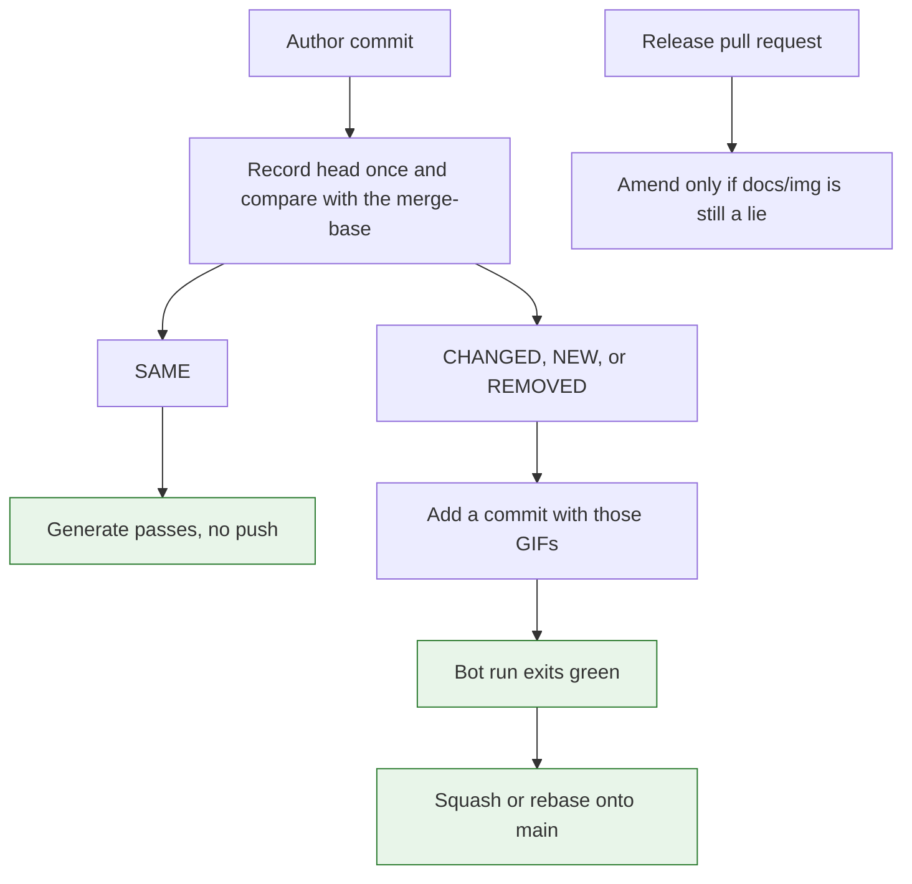

# Architecture Decision: Commit Demo GIFs on the Pull Request

Superseded in part on 2026-11-04. NOISY and UNSTABLE are committed with the head GIF. Only SAME skips the GIF commit.

## Requirements & Constraints

Ranked quality attributes:

1. When a pull request that changes a demo merges, `docs/img/` on `main` matches that code.
2. A later pull request is blamed only for the demos it changed.
3. A solo author is not rewritten. A push happens only when a demo changed, and it adds a commit.
4. The release commit and its tag already contain the GIFs. A release still repairs `docs/img/` if a pull request reached `main` without them.
5. The required check runs for every pull request that can merge to `main`.
6. The pull request head is recorded once.

Technical constraints, from the repository as it is today:

- The `main` ruleset requires a pull request, linear history, and squash or rebase. It forbids a non-fast-forward update. The only bypass actor is the repository admin role. The demo GitHub App is not a bypass actor, so a workflow cannot push straight to `main`.
- The ruleset already requires the status check named `Generate`. That string is the job name in `.github/workflows/generate-demos.yaml`. The policy is loose: the branch does not have to be up to date with `main` before merge.
- Required approvals are zero. Dismissing stale reviews on push is on, and it does not block a merge while the approval count stays zero. The extra Copilot-approval setting has no effect at zero approvals.
- Feature squash `#189` did not change `docs/img/`. Those GIF bytes landed later, inside the squash of release `3.0.0` (`#187`). That is the lag this decision closes.
- The historical bot-commit fixes (`9e25889`, `ee64936`, `afc682c`, `9f040d7`, `4a59a7b`) stop a regenerate loop on release-please. The working brake is `github.actor == demo-generation-doggo[bot]`, which exits the job green so `Generate` still counts. The committer check looks for `demo-generation-bot`, which is not the committer this workflow writes. Issue #190 then forbade feature-branch bot commits so that loop would not come back.
- The fingerprint compares a recording of the pull request with a recording of the merge-base. The byte diff compares a new GIF with the file committed on `main`.

In scope: where the GIF commit is written, what `Generate` proves, and how a release still covers a miss.

Out of scope: the verdict rule, the comment wording, and turning on the ruleset's strict up-to-date checkbox.

## Components

The comment keeps the merge-base comparison. The GIF commit is a separate write, and only the demos whose verdict says the committed file would be a lie are in it.

## Options Evaluated

- **Wait for the release**: The comment uses the fingerprint, so a later pull request is not blamed for an earlier change. `docs/img/` on `main` stays wrong until the release squash, which is what `#189` and `#187` already do.
- **Additive commit on the pull request**: When the verdict is CHANGED, NEW, or REMOVED, the workflow adds one commit to the pull request branch. Squash and rebase both bring those files onto `main`. `Generate` stays red on the author's commit until that push has moved the head. The release amends only when `docs/img/` is still wrong.
- **Push to `main` after merge**: A job on `push` to `main` writes the GIFs. The ruleset rejects that push. A follow-up pull request leaves the same lag the release has today, and the merge commit itself does not contain the GIFs.
- **Merge queue**: The ruleset has no merge queue. The queue ref is not a branch this repository writes commits to.

## Analysis

| Criterion | Wait for the release | Commit on the pull request | Push to main after merge |
|-----------|----------------------|----------------------------|--------------------------|
| Fitness | The comment is fair. The README on `main` is late. | The merge that changes the demo also changes `docs/img/`. | The ruleset blocks the push. A follow-up pull request is late. |
| Constraints | No new commit on the author's branch. | One fast-forward commit, and only when a demo changed. The App can push to the pull request branch. | The App cannot push to `main`. |
| Simplicity | The current plan. | The release amend already knows how to commit GIFs. The feature path adds a commit instead of amending. | Needs a bypass actor or a second pull request. |
| Maintainability | The false blame and the stale README stay easy to confuse. | The comment and the committed files answer different questions, and both are current after merge. | Two writes can race. |
| Risk | Reversible, and it misses attribute 1. | The author of a demo-changing pull request must pull before the next push. A force-push drops the GIF commit and `Generate` goes red until the workflow adds it again. | Reversible only by giving the App the admin bypass. |

Key insights:

- The story of a later pull request being blamed for an earlier display change is the byte diff. That diff compares the new recording with the GIF file on `main`. The fingerprint compares two recordings of code. After the earlier pull request has merged, both recordings include it, and the later pull request reads SAME. Landing the GIF on `main` is what keeps the README honest. It is not what makes the later comment fair.
- A release-please amend exists because a regenerate always saw new GIF bytes and rewrote the same commit. The actor exit is what stopped that. A fingerprint does not remove the loop by itself: the pull request still differs from `main` after the GIF commit, because the code change is still on the branch. The push has to stop once the head is the commit that wrote those GIFs.
- Squash folds the extra commit into the one commit on `main`. Rebase keeps it as its own commit. Either way the files are on `main` before a release, so the release commit has no GIF delta unless the backstop finds a miss.
- `Generate` is already required, and the workflow already runs on every `pull_request` to `main`, with no path filter. A new check name would be a check some pull request might never report. A skipped job does not satisfy a required check. The bot's early green exit does, which is why that exit has to stay on the commit that contains the GIFs.
- Loose required checks mean a green `Generate` from before `main` moved can still merge. A pull request that never touched `docs/img/` does not revert a newer GIF on squash. A long-lived pull request that already has its own GIF commit can. The strict checkbox would close that. It is a repository-wide "update branch before merge" rule, and this decision does not turn it on.

## Decision

### Choice Pre-Mortem

- The later pull request is blamed unless the GIF lands immediately: checked. The fingerprint comment does not use the committed GIF. The commit exists so `main` matches the code.
- "Cannot possibly merge" includes an admin and a stale green check: checked, and not claimed. Admins bypass the ruleset. Loose checks do not re-run after `main` moves. The guarantee is the current head of this pull request.
- The old regenerate loop returns: checked. The second run is the bot actor and does not push again. A later author commit is a new head, and the workflow can push again.

**Selected**: Additive commit on the pull request
**Rationale**: It is the option that puts the new GIFs on `main` in the merge the author is already making. A direct push to `main` cannot get past the ruleset, and waiting for the release leaves the README stale.
**Tradeoff**: The author of a pull request that changes a demo is one commit behind the remote until they pull. A pull request that does not change a demo is left untouched. The strict up-to-date checkbox stays off, so a branch that was green before `main` moved is not forced to re-run.

## Implementation Notes

- Record the head once. That recording is the fingerprint and the GIF that gets committed. Keep one recording of the merge-base for the comparison. Do not run `demo:generate:all` as a second take of the head.
- On a human commit, push only for CHANGED, NEW, and REMOVED. Add a commit. Do not amend and do not force-push. The commit contains only those `docs/img/` files.
- The author's `Generate` run must finish by moving the branch, or fail the check if the push did not happen. The following run, whose actor is the demo app, exits green without recording again.
- Keep the job name `Generate`. Keep the workflow on `pull_request` to `main` with no path filter. Do not skip the job.
- The comment on that pull request says a demo commit was added and the author should pull before pushing.
- A release-please pull request still amends, with `--force-with-lease`, when a comparison with the commit that last touched `docs/img/` is CHANGED, NEW, or REMOVED. When every feature landed its GIFs, that amend does not run, and the release commit has no GIF delta.
- The committer-name check for `demo-generation-bot` stays a dead branch. The actor check is the brake.
- Fork pull requests cannot receive the app push. A fork that changes a demo fails `Generate` until the GIFs are on the head. A fork that changes no demo passes.
