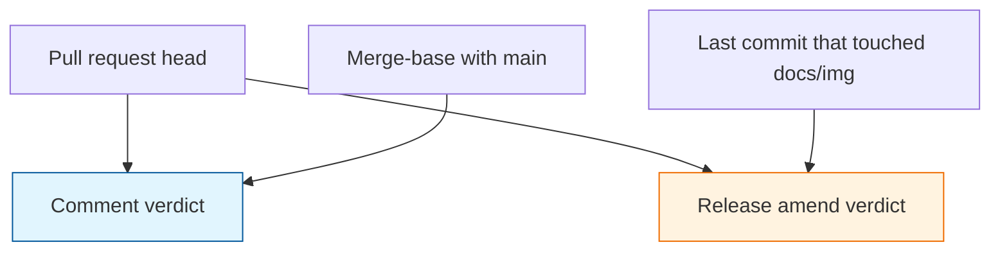

# Architecture Decision: Release GIF Amend Base

## Requirements & Constraints

Ranked quality attributes:

1. A pull-request comment tells the truth about that pull request. Collapsed and marked SAME means this pull request did not change what that demo shows.
2. The committed README GIFs in `docs/img/` are replaced when behavior since they were produced has changed, and left untouched when it has not.
3. A feature pull request gets no bot commit.
4. Frame hashes are never committed. A frame comparison runs both sides in one job, on one runner, from each side's own `demos/Dockerfile`.
5. Simplicity, then CI time.

Technical constraints:

- The fingerprint and retry rules stay as they are.
- Release-please pull requests are version and changelog commits on top of `main`. They do not carry the feature diff. The merge-base of that pull request with `main` is current `main`.
- Feature pull requests do not commit GIFs, so `main` can contain new prompt code and old GIF bytes.
- The amend loop stops because a push by `demo-generation-doggo[bot]` exits the workflow at the actor check.
- Issue #190 allows a committed text fingerprint only if the release flow needs a reference, and forbids committed frame hashes.

In scope: which trees the release amend compares, and which verdicts are allowed to change `docs/img/`.

Out of scope: the comment's merge-base comparison, the fingerprint rule, and the before/after layout.

## Components

The comment path runs on every pull request. The amend path runs only on a release-please pull request, and only when the GIF commit is not the same tree as the head.

`scripts/demo-fingerprint.ts` is still the only place that turns two recordings into a verdict. The workflow chooses the two trees.

## Options Evaluated

- **Merge-base only**: The release amend uses the same head-versus-merge-base verdict as the comment. A version-bump release compares current `main` with itself and reads SAME, so a GIF left stale by a feature merge never updates.
- **Committed text fingerprint**: When an amend writes a GIF, it also commits that demo's normalized text. The next release records only the head and amends when the text differs. Color-only changes have no portable fingerprint, so they never update the README.
- **GIF-commit base**: On a release pull request, record the commit that last touched `docs/img/` and the release head in the same job. Reuse the existing verdict rule. Amend the GIF files that are CHANGED, NEW, or REMOVED. Leave SAME, UNSTABLE, and NOISY bytes unstaged.
- **Feature-branch bot commit**: Write the GIF on the feature pull request that changed the demo. This is forbidden.

## Analysis

| Criterion | Merge-base only | Committed text | GIF-commit base |
|-----------|-----------------|----------------|-----------------|
| Fitness | Comment stays true. README GIFs freeze after the last amend. | Text changes since the last amend are caught. Color changes are not. | Comment stays on the merge-base. README GIFs follow behavior since they were produced, including color. |
| Constraints | No new committed artifact. Misses attribute 2. | No frame hashes. Misses color, which is why frames exist. | No frame hashes. Both sides share the job. Feature PRs stay commit-free. |
| Simplicity | One comparison. | A new committed artifact and a second comparison kind. | A second base SHA on release pulls only. Same verdict function. |
| Maintainability | The stale-GIF hole is invisible in the comment. | Two stores of truth, text and GIF, can drift. | One verdict function, two explicit questions. |
| Risk | Reversible, and wrong: the README stops tracking the prompt. | Reversible. Wrong for a color-only release. | Reversible. Extra recording is release-only. |

Key insights:

- The comment asks "what did this pull request change?" The amend asks "are the committed GIF bytes still true?" On a feature pull request those questions share a base. On a release pull request they do not.
- A committed text fingerprint cannot see color. The issue added frames specifically for that, and forbade storing their hashes. Re-recording the old tree in the same job is the comparison that keeps frames valid.
- NEW and REMOVED must be allowed to amend. A new tape has no GIF yet, and a removed tape would otherwise leave a dead GIF in the README. The issue's word CHANGED is the name of the proven-difference verdict; the amend set is the verdicts that would make `docs/img/` a lie: CHANGED, NEW, and REMOVED.

## Decision

### Choice Pre-Mortem

- The last `docs/img/` commit is not the code that produced those GIFs: checked. The amend adds GIF bytes onto the release commit that was just recorded, and feature pulls do not commit GIFs, so that commit remains the producer until the next amend.
- A release comment that says SAME while the amend updates GIFs will look contradictory: checked, and accepted. Those GIFs changed on an earlier feature pull request, whose comment was the place that showed before and after. The release comment is about the version bump.
- `git log -1` for `docs/img` can point at a non-ancestor: checked. Release branches are cut from `main`, and GIF commits land on `main` through the merged release pull request.

**Selected**: GIF-commit base
**Rationale**: It is the only option that keeps the comment truthful and still refreshes README GIFs, including color, without a feature-branch commit or a stored frame hash.
**Tradeoff**: A release-please job records one extra tree when the last GIF commit is not the merge-base. The release comment can say SAME while the amend updates GIFs that an earlier pull request changed.

## Implementation Notes

- Comment base stays the merge-base with `main`, on every pull request.
- Amend base is `git log -1 --format=%H -- docs/img` resolved from the release pull request's base, compared with the release head.
- Reuse `assessFingerprints`. Do not add a second verdict rule.
- Stage only CHANGED and NEW GIFs. `git rm` REMOVED GIFs. Do not stage SAME, UNSTABLE, or NOISY. If nothing is staged, do not amend.
- `demo:generate:all` may still rewrite every GIF in the worktree. The amend must restore the unstaged ones before it commits, or copy the new bytes in from the scratch recording instead of staging the worktree.
- No text fingerprint is committed. The issue allows one only when a reference is required, and this base is that reference.
