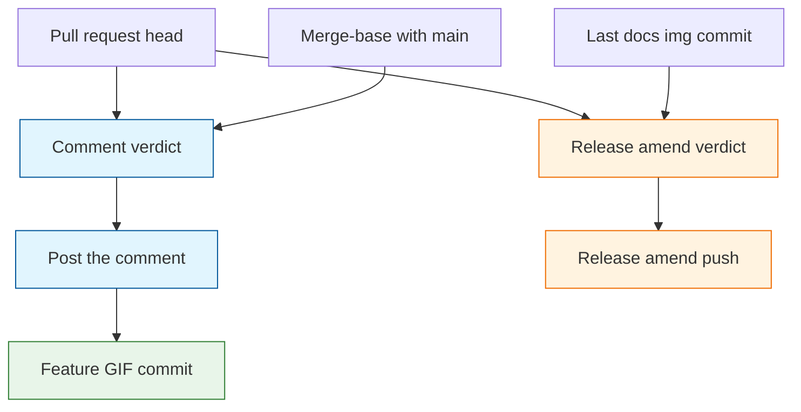

# Task: Promote demo verdicts out of shadow

* Task ID: issue-190-promote
* Complexity: Level 3
* Type: feature

The fingerprint verdicts already recorded on a pull request become the thing that expands, collapses, and labels each demo. A pull request that changes a demo adds one commit with those GIFs so squash or rebase lands them on `main`. A release-please pull request amends `docs/img/` only when those files are still wrong. The detector does not change.

This revision answers the preflight that failed the previous plan. The comment body, the image-list parse, and the template fill are tested functions. The head GIF that gets uploaded and committed is attempt 0 of the scratch recording. The comment is posted before any push. A release-please branch never takes the feature GIF commit.

## Pinned Info

### Two comparisons, then the comment, then one push

The comment and the release repair ask different questions. One verdict function serves both. The workflow chooses the base tree. The comment is posted before either push, because a push to a non-release branch cancels this job. A feature pull request writes GIFs only for CHANGED, NEW, and REMOVED. A release-please pull request never takes that commit. It amends only when `docs/img/` is still a lie.

The workflow takes FeaturePush or ReleasePush, never both. FeaturePush is skipped when the branch name starts with `release-please-`.

## Component Analysis

### Affected Components

- `scripts/demo-fingerprint.ts`: Turns two recordings into a verdict. Gains `describeVerdict`, the ffmpeg stack arguments, and exports for `tapeNames` and `attemptsForDemo`. The retry rule stays. `formatShadowLine` drops the unused-verdict sentence. The job summary keeps that line.
- `scripts/demo-comment.ts` (new): Renders the comment blocks, diffs text, chooses amend paths, names the attempt-0 GIF copies, parses the upload list, fills the template, and exposes the CLI the workflow calls. It does not record tapes, run git, or run Docker.
- `.github/workflows/generate-demos.yaml`: Stops using the GIF byte diff and stops running `demo:generate:all` as a second take of the head. Records the merge-base and the head once, copies attempt-0 GIFs into `docs/img/`, posts the comment, then either adds one feature commit or amends a release. The job name stays `Generate`.
- `.github/workflows/scripts/templates/demo-comment.md`: Drops the shadow disclaimer. Gains a `${PULL_NOTICE}` token. The per-demo blocks come from `renderDemoComment`.
- `.github/workflows/scripts/generate-demo-comment.sh`: Builds the comment today, including the upload-failure sentence and the `https` GIF check. Those behaviors move into `scripts/demo-comment.ts`. The script is removed.
- `.github/workflows/scripts/detect-demo-changes.sh`: Compares GIF bytes. Nothing else may call it, and it is removed.
- `memory-bank/techContext.md`: Says expand and the release amend still follow the GIF diff. That sentence becomes false.

`src/index.ts` is the prompt described in `memory-bank/systemPatterns.md`. This task does not touch it. `scripts/generate-demo.js` stays the GIF-only recorder. `commit-demo-changes.sh` is unreferenced and stays as it is.

### Cross-Module Dependencies

- The workflow records tapes with `scripts/generate-demo.js`. That script must not import `demo-fingerprint.ts` beyond the import it already has, and it must not import `demo-comment.ts`.
- Scratch layout for attempt 0, side `head`, demo `basic`: `<scratch>/attempt-0/head/basic/basic-demo.gif`. The host path is the scratch directory the workflow passes to `--scratch`, which is `<shadow>/scratch/attempt-<n>/<side>`.
- `demo-comment.ts` reads that tree through `readSide`, `tapeNames`, and `attemptsForDemo`. The copy planner returns paths and does not copy files. The workflow copies them.
- The upload script publishes every `docs/img/*-demo.gif` and prints `name:url` pairs, or the sentinel `❌ Failed to upload demo images`. The comment's demo list comes from the tapes, not from every uploaded name. Stripping `-demo.gif` is how `basic-before-after-demo.gif` becomes the key `basic-before-after`.
- A feature pull request posts the comment, then adds one commit. It does not amend and it does not force-push. A release-please pull request posts the comment, then may amend and `--force-with-lease`. The feature commit step's `if` requires `is_release_please != 'true'`.

### Boundary Changes

- `describeVerdict` is a new exported result beside `assessFingerprints`. `assessFingerprints` keeps its return type.
- `tapeNames` and `attemptsForDemo` become exports. Their behavior does not change.
- `renderDemoComment` returns `{ statusMessage, demoList, pullNotice }`. `pullNotice` is empty unless the caller passes `gifCommitAdded: true`.
- `fillCommentTemplate` replaces only the known tokens, with a function replacer so a diff containing `$&` or `$1` stays literal.
- The comment body for a demo gains a verdict word. SAME, NOISY, and UNSTABLE are collapsed. CHANGED, NEW, and REMOVED are open. See `memory-bank/active/creative/creative-unspecified-verdicts.md`.
- A demo-changing feature pull request gains one GIF commit before merge. See `memory-bank/active/creative/creative-commit-demos-on-merge.md`. The operator accepted that decision and will require pull request branches to be up to date with `main`.
- The release amend's inputs change from "any GIF byte differs" to the path list from `selectReleaseAmend`. See `memory-bank/active/creative/creative-release-gif-amend.md`.
- No package export, npm API, or committed fingerprint file changes.

### Invariants & Constraints

- `assessFingerprints` keeps the pinned retry rule.
- A frame comparison's two sides are recorded in the same job. Frame hashes are not committed.
- Attempt 0 is the GIF that is uploaded and, when the verdict requires it, committed. Attempt 1 exists only so the retry rule can run. It is not copied into `docs/img/`.
- The committed GIF is that scratch recording, including the extra `Output` lines `withFingerprintOutputs` appends. Do not run `demo:generate:all` to get a different look.
- A feature pull request adds one commit, and only when a verdict against `main` is CHANGED, NEW, or REMOVED, and only when the branch is not a release-please branch. SAME, NOISY, and UNSTABLE do not push. The commit stages only the paths `selectReleaseAmend` returns. Preview names (`<name>-before-demo.gif`, `<name>-before-after-demo.gif`) are not in that list.
- The comment is posted before that push. `concurrency.cancel-in-progress` is true for non-release branches, so a push earlier in the job cancels the run before the comment exists.
- The following run, whose actor is the demo app, exits green and does not record again. A later human commit is judged against `main` again, so a README-only commit can add another GIF commit. The operator accepted that on 2026-11-03 and said not to add machinery that compares the new head with the GIFs already on the branch.
- UNSTABLE and NOISY still exit 0. `NEED_FRAME_RETRY` is internal: after the workflow's retry, a comment entry with that verdict is a failed job, not a SAME block.
- The GIF-only generator does not import `demo-comment.ts`.
- Do not point container `TMPDIR` at the scratch mount. Do not create `/tmp/vhs-frames` before `vhs`.
- `envsubst` does not see the comment body. `String.prototype.replace` does not see it either, except through a function replacer.
- The amend stages only the paths `selectReleaseAmend` returns, and restores every other `docs/img/*-demo.gif` before it commits.
- The feature commit step does not run when `is_release_please` is true.

## Open Questions

- [x] Which trees decide a release-please GIF amend? → Resolved: last `docs/img/` commit versus the release head. Stage CHANGED, NEW, and REMOVED only (`memory-bank/active/creative/creative-release-gif-amend.md`)
- [x] How does the comment present REMOVED, UNSTABLE, and NOISY? → Resolved: collapse SAME, NOISY, and UNSTABLE with the verdict word. Open CHANGED, NEW, and REMOVED (`memory-bank/active/creative/creative-unspecified-verdicts.md`)
- [x] How does a demo-changing pull request update `docs/img/` on `main`? → Resolved: add one commit on the pull request with the single head recording. The operator will require branches to be up to date. The release amend stays a repair (`memory-bank/active/creative/creative-commit-demos-on-merge.md`)
- [x] Where does the pull-before-push notice live? → Resolved in this revision, no new creative document: `renderDemoComment` returns `pullNotice`. It is `A demo commit was added to this branch. Pull before you push.` when `gifCommitAdded` is true, and `''` otherwise. `fillCommentTemplate` places it at `${PULL_NOTICE}`. The workflow sets the flag only on the feature path, before the push, because the comment has to be posted first.
- [x] Which bytes land in `docs/img/` for upload and for the commit? → Resolved in this revision: copy attempt 0 only. Head GIF to `docs/img/<name>-demo.gif` for every demo that is not REMOVED. Base GIF to `docs/img/<name>-before-demo.gif` for REMOVED. Stacked preview to `docs/img/<name>-before-after-demo.gif` for CHANGED. After the upload script returns, copy the commit paths from scratch again so a branch switch inside the upload cannot restore stale bytes.

The preflight advisory to move the whole pipeline into one `runDemoPipeline` is declined. The blocking gaps are the functions and the step order above. The operator already accepted this workflow shape.

## Test Plan (TDD)

### Behaviors to Verify

- Text matches and frames differ, and the retry repeats that: `describeVerdict` → `CHANGED` and `stylingOnly: true`
- Text differs: `describeVerdict` → `CHANGED` and `stylingOnly: false`
- SAME, NEW, REMOVED, UNSTABLE, NOISY, and `NEED_FRAME_RETRY`: `stylingOnly: false`
- Two equal normalized records: `formatTextDiff` → empty string
- The issue's one-character validation lines: the result contains the old line prefixed with `-` and the new line prefixed with `+`, and does not list an unchanged `Search:` line as both
- SAME entry: collapsed `
`, summary is `📷 demos/<name>.gif (SAME)`, body contains ``
- NOISY and UNSTABLE: collapsed, summary is `📷 demos/<name>.gif (NOISY)` or `📷 demos/<name>.gif (UNSTABLE)`, body contains ``
- CHANGED with a text diff: open `
`, summary is `🔥 demos/<name>.gif (CHANGED)`, body contains `` and a collapsed block whose summary is `Text diff` and whose body contains the diff
- CHANGED with `stylingOnly`: open, summary is `🔥 demos/<name>.gif (CHANGED, styling only)`, no text-diff block
- NEW: open, summary is `✨ demos/<name>.gif (NEW)`, body contains `` and not a stacked image
- REMOVED: open, summary is `🗑️ demos/<name>.gif (REMOVED)`, body contains ``
- `NEED_FRAME_RETRY`: `renderDemoComment` throws
- CHANGED without a stacked URL, or REMOVED without a before URL: throws
- `gifCommitAdded` omitted or false: `pullNotice` is `''`
- `gifCommitAdded: true`: `pullNotice` is `A demo commit was added to this branch. Pull before you push.`
- Every entry SAME: `statusMessage` is `✅ **Demos are stable** - No changes detected in demo output.`
- Any CHANGED, NEW, or REMOVED: `statusMessage` is `⚠️ **Changes detected** - Please review the generated demos to ensure they accurately represent the library.`
- Only SAME plus NOISY: `statusMessage` is `⚠️ **No proven demo change** - These recordings are NOISY.` It does not contain the stable sentence or the warning sentence
- Only SAME plus UNSTABLE: `statusMessage` is `⚠️ **No proven demo change** - These recordings are UNSTABLE.`
- SAME plus both NOISY and UNSTABLE: `statusMessage` is `⚠️ **No proven demo change** - These recordings are NOISY and UNSTABLE.`
- No entries: stable banner, and `demoList` is `No demo images available.`
- `selectReleaseAmend`: CHANGED and NEW produce `docs/img/<name>-demo.gif` in `stage`; REMOVED produces that path in `remove`; SAME, NOISY, UNSTABLE, and `NEED_FRAME_RETRY` produce neither. Preview names are absent
- An unsafe demo name: `selectReleaseAmend` throws
- `formatAmendList`: one `stage` or `remove` line per path, stable order
- Scratch fixture with a frame-only change and a URL map: `loadCommentEntries` sets `stylingOnly`, leaves the text diff empty, and copies the stacked URL
- A URL map that also contains `<name>-before-after` does not add a demo. The demo list length follows the tapes
- A CHANGED text demo without its stacked URL: `loadCommentEntries` throws
- `planDocsImgCopies`: a non-REMOVED demo maps `<scratch>/attempt-0/head/<name>/<name>-demo.gif` to `docs/img/<name>-demo.gif`. A REMOVED demo maps `<scratch>/attempt-0/base/<name>/<name>-demo.gif` to `docs/img/<name>-before-demo.gif` and does not emit a head path. No returned path contains `attempt-1`. An unsafe name throws
- `buildDockerFfmpegStackArgs`: uses the given image, mounts the before, after, and output directories, includes the issue's `vstack` filter, and does not set `TMPDIR`
- `formatShadowLine`: `Demo verdicts: basic SAME, validation NEED_FRAME_RETRY.` The line does not contain `not used` and does not contain a newline
- `parseDemoImageList`: empty string returns `{}`. `basic:https://example.com/basic-demo.gif other:https://example.com/other-demo.gif` splits on the first colon and returns both. The sentinel `❌ Failed to upload demo images` throws. A URL that is not `https://` and ending in `.gif` throws. An unsafe name throws
- `fillCommentTemplate`: replaces `CHANGE_STATUS_MESSAGE`, `DEMO_LIST`, `PULL_NOTICE`, `GITHUB_REPOSITORY`, `GITHUB_SHA`, and `USER_COMMIT_SHA`. A `DEMO_LIST` value containing `$&` and `$1` appears unchanged. A missing known token throws. Text that is not one of those tokens is left in place
- `parseCommentArgs`: comment mode requires `--scratch`, `--base-tapes`, `--head-tapes`, `--images`, `--template`, `--repository`, `--github-sha`, and `--user-commit-sha`. `--gif-commit-added` sets a boolean. `copies` and `amend` require the scratch and tape flags only. An unknown flag throws. A missing required flag throws
- `runCommentCli` comment mode, on a SAME scratch fixture whose image list is the upload-failure sentinel: exit 0, body contains `❌ Failed to upload demo images for preview.`, body does not contain `<details`
- `runCommentCli` comment mode, on a CHANGED fixture whose diff contains `$&`: exit 0, body contains that `$&` and the CHANGED summary
- `runCommentCli` copies mode: stdout contains the attempt-0 head path and does not contain `attempt-1`
- `runCommentCli` amend mode, on a CHANGED fixture: stdout contains `stage docs/img/<name>-demo.gif`

### Test Infrastructure

- Framework: Vitest, via `npx vitest run -t "TEST_NAME"` and `npm test`
- Test location: `scripts/demo-fingerprint.test.ts` and `scripts/demo-comment.test.ts`
- Conventions: `describe` per function, `it` names the observable behavior, fixtures under `mkdtempSync`
- New test files: `scripts/demo-comment.test.ts`

### Integration Tests

- `loadCommentEntries` reads a scratch tree written the way `assessScratch` reads it, and returns the entries `renderDemoComment` and `selectReleaseAmend` consume. No Docker and no git.
- `runCommentCli` comment mode runs `loadCommentEntries`, `renderDemoComment`, `parseDemoImageList`, and `fillCommentTemplate` on that fixture. No Docker and no git.

## Implementation Plan

### 1. Styling-only flag — executable

- [x] Done

- Files: `scripts/demo-fingerprint.ts`, `scripts/demo-fingerprint.test.ts`
- Creative ref: `memory-bank/active/creative/creative-unspecified-verdicts.md`

1. Stub tests: in `scripts/demo-fingerprint.test.ts`, empty cases for text-mismatch CHANGED, frame-stable CHANGED, and one non-CHANGED verdict.
2. Stub interface: `export function describeVerdict(input: AssessmentInput): { assessment: Assessment; stylingOnly: boolean }` with a doc comment. Body throws.
3. Write tests and run red: styling-only is true only for a CHANGED verdict whose first attempt has equal text and unequal frames. Every other verdict is false. `assessFingerprints` expectations stay as they are.
4. Write code and run green: `describeVerdict` calls `assessFingerprints` and sets the flag from the first attempt's text. Do not change the retry rule.

### 2. Text diff — executable

- [x] Done

- Files: `scripts/demo-comment.ts`, `scripts/demo-comment.test.ts`

1. Stub tests: empty cases for equal records and for the one-character validation pair.
2. Stub interface: `export function formatTextDiff(baseText: string, headText: string): string`. Body throws.
3. Write tests and run red: equal strings return `''`. The validation pair's result contains `-` plus the old line and `+` plus the new line, and an unchanged `Search:` line is not emitted as both an add and a remove.
4. Write code and run green: a line diff with no new dependency. Identical input returns an empty string.

### 3. Comment body — executable

- Files: `scripts/demo-comment.ts`, `scripts/demo-comment.test.ts`, `.github/workflows/scripts/templates/demo-comment.md`
- Creative ref: `memory-bank/active/creative/creative-unspecified-verdicts.md`

1. Stub tests: one empty case per `renderDemoComment` behavior in the test plan, including `pullNotice` for both flag values and the three mixed banners.
2. Stub interface: `DemoCommentEntry` and `export function renderDemoComment(entries: readonly DemoCommentEntry[], options?: { gifCommitAdded?: boolean }): { statusMessage: string; demoList: string; pullNotice: string }`. Body throws.
3. Write tests and run red: assert the exact summary strings, open versus collapsed, the image markdown, the styling-only label, the collapsed `Text diff` block, the three banner sentences, the mixed-verdict sentences, the empty list, `pullNotice`, and the throws.
4. Write code and run green: render those blocks. `pullNotice` is the pinned sentence only when `gifCommitAdded` is true. Do not fill the template in this unit.

### 4. Release amend selection — executable

- Files: `scripts/demo-comment.ts`, `scripts/demo-comment.test.ts`
- Creative ref: `memory-bank/active/creative/creative-release-gif-amend.md`

1. Stub tests: empty cases for stage, remove, ignore, unsafe name, and the line formatter.
2. Stub interface: `export function selectReleaseAmend(entries: readonly { name: string; assessment: Assessment }[]): { stage: string[]; remove: string[] }` and `export function formatAmendList(selection: { stage: string[]; remove: string[] }): string`. Bodies throw.
3. Write tests and run red: paths are `docs/img/<name>-demo.gif`. CHANGED and NEW stage. REMOVED removes. SAME, NOISY, UNSTABLE, and `NEED_FRAME_RETRY` do neither. Preview names are absent. An unsafe name throws. The formatter emits `stage <path>` and `remove <path>` lines.
4. Write code and run green: call `assertSafeDemoName`. Sort by demo name.

### 5. Load comment entries from scratch — executable

- Files: `scripts/demo-comment.ts`, `scripts/demo-comment.test.ts`, `scripts/demo-fingerprint.ts`

1. Stub tests: an empty case for a frame-only scratch fixture, an empty case for a missing stacked URL, and an empty case that the extra `<name>-before-after` URL does not become a demo.
2. Stub interface: export the existing `tapeNames` and `attemptsForDemo` from `scripts/demo-fingerprint.ts`. Add `export function loadCommentEntries(options: { scratchRoot: string; baseTapesDir: string; headTapesDir: string; imageUrls: Readonly<Record<string, string>> }): DemoCommentEntry[]`. Body throws.
3. Write tests and run red: a fixture with equal normalized text, unequal settled frames, and a `basic-before-after` URL yields `stylingOnly: true`, an empty text diff, and that stacked URL. A second URL key that is not a tape name does not add an entry. A CHANGED text demo without its stacked URL throws.
4. Write code and run green: reuse `describeVerdict`, `readSide`, `tapeNames`, `attemptsForDemo`, and `formatTextDiff`. Head URL key is the demo name. Stacked key is `<name>-before-after`. Removed before key is `<name>-before`. Demo names come from the tapes.

### 6. Docs image copy plan — executable

- Files: `scripts/demo-comment.ts`, `scripts/demo-comment.test.ts`

1. Stub tests: empty cases for a head copy, a REMOVED copy, and an unsafe name.
2. Stub interface: `export function planDocsImgCopies(options: { scratchRoot: string; entries: readonly { name: string; assessment: Assessment }[] }): { from: string; to: string }[]`. Body throws.
3. Write tests and run red: non-REMOVED maps attempt-0 head `<name>/<name>-demo.gif` to `docs/img/<name>-demo.gif`. REMOVED maps attempt-0 base to `docs/img/<name>-before-demo.gif` and emits no head path. No path contains `attempt-1`. An unsafe name throws.
4. Write code and run green: return those pairs in `to`-path order. Do not copy files and do not read the scratch tree.

### 7. FFmpeg stack arguments — executable

- Files: `scripts/demo-fingerprint.ts`, `scripts/demo-fingerprint.test.ts`

1. Stub tests: an empty case for the stack arguments.
2. Stub interface: `export function buildDockerFfmpegStackArgs(options: { image: string; beforeGif: string; afterGif: string; outputGif: string }): string[]`. Body throws.
3. Write tests and run red: the argv uses `options.image`, bind-mounts the three parent directories, includes `[0][1]vstack=inputs=2,split[a][b];[a]palettegen=stats_mode=diff[p];[b][p]paletteuse=dither=none`, and contains no `TMPDIR`.
4. Write code and run green: `docker run --rm` with `--entrypoint ffmpeg`. The output mount is writable. The inputs are read-only. This function does not run Docker.

### 8. Shadow line — executable

- Files: `scripts/demo-fingerprint.ts`, `scripts/demo-fingerprint.test.ts`

1. Stub tests: the existing `formatShadowLine` case is the test. Change its expected sentence in the write-tests step, not before.
2. Stub interface: none. The function already exists.
3. Write tests and run red: expect `Demo verdicts: basic SAME, validation NEED_FRAME_RETRY.` and expect the line not to contain `not used`.
4. Write code and run green: change the sentence in `formatShadowLine` and its doc comment. The job summary keeps the line. The comment template does not.

### 9. Image list and template fill — executable

- Files: `scripts/demo-comment.ts`, `scripts/demo-comment.test.ts`, `.github/workflows/scripts/templates/demo-comment.md`

1. Stub tests: empty cases for a pair list, the upload-failure sentinel, a non-https URL, an equal template fill, and a `DEMO_LIST` value that contains `$&`.
2. Stub interface: `export function parseDemoImageList(raw: string): Record<string, string>` and `export function fillCommentTemplate(template: string, tokens: { CHANGE_STATUS_MESSAGE: string; DEMO_LIST: string; PULL_NOTICE: string; GITHUB_REPOSITORY: string; GITHUB_SHA: string; USER_COMMIT_SHA: string }): string`. Bodies throw.
3. Write tests and run red: empty input returns `{}`. Pairs split on the first colon. The sentinel throws. A URL that fails `^https://.*\.gif$` throws. An unsafe name throws. Filling a template leaves `$&` and `$1` literal. A missing token throws. An unknown `${...}` token is left in place.
4. Write code and run green: parse and fill. The replacement callback receives the matched token and returns the value, so `replace` does not interpret `$`. Update the template in this same green step: remove the `${SHADOW_VERDICTS}` line, add `${PULL_NOTICE}`, and keep the other known tokens. Do not run `envsubst` on the result.

### 10. Comment CLI — executable

- Files: `scripts/demo-comment.ts`, `scripts/demo-comment.test.ts`

1. Stub tests: empty cases for comment-mode flags, a missing flag, copies-mode stdout, amend-mode stdout, the upload-failure comment, and a CHANGED comment whose diff contains `$&`.
2. Stub interface: `export function parseCommentArgs(argv: readonly string[]): CommentArgs` and `export function runCommentCli(argv: readonly string[], io: { stdout: { write: (chunk: string) => void }; stderr: { write: (chunk: string) => void } }): number`. Bodies throw. Add a direct-run guard in the green step, matching `scripts/demo-fingerprint.ts`.
3. Write tests and run red: the flag requirements in the test plan. Copies stdout names attempt 0 and not attempt 1. Amend stdout contains `stage docs/img/<name>-demo.gif`. The sentinel comment exits 0 and contains `❌ Failed to upload demo images for preview.` The `$&` diff survives in the written body.
4. Write code and run green: comment mode loads entries, parses images, renders, and fills the template. On the upload sentinel it still exits 0 and uses that failure sentence as `DEMO_LIST` instead of the demo blocks. `copies` prints `from\tto` lines from `planDocsImgCopies`. `amend` prints `formatAmendList`. Unknown flags and bad URLs exit 1 via `stderr`.

### 11. Wire the workflow — executable

- Files: `.github/workflows/generate-demos.yaml`, `.github/workflows/scripts/generate-demo-comment.sh`, `.github/workflows/scripts/detect-demo-changes.sh`, `.github/workflows/scripts/templates/demo-comment.md`
- Creative ref: `memory-bank/active/creative/creative-commit-demos-on-merge.md` and the two earlier creative documents
- Behavior tests: steps 1–10. No test locks a YAML or shell string.

1. Stub tests: none. A test that the workflow file contains a command is a change-detector.
2. Stub interface: none. The CLI already exists.
3. Write tests and run red: none.
4. Write code and run green, in this order:
    1. Keep the demo-bot early exit and the job name `Generate`. Do not add a path filter and do not skip the job.
    2. Record the merge-base and the head once each, the way the shadow step records them today. Do not run `demo:generate:all`. Retry `NEED_FRAME_RETRY` into attempt 1. Attempt 1 is not a GIF source.
    3. Run `node scripts/demo-comment.ts copies` and copy those pairs into the worktree. For each CHANGED demo, run `buildDockerFfmpegStackArgs` and write `docs/img/<name>-before-after-demo.gif`.
    4. Run the artifact upload and `upload-demo-images.sh` after those files exist.
    5. Run `node scripts/demo-comment.ts comment` with `--gif-commit-added` only when this is a feature pull request and the amend list is non-empty. Write that body to the pull-request comment. Do not pass `--changed-demos` or `--new-demos`. Do not run `envsubst`.
    6. Delete the "Check which demos changed" step.
    7. On a feature pull request, after the comment step, when the amend list is non-empty, copy the commit paths from scratch again and add one commit with only those paths. `git add` the `stage` paths. `git rm` the `remove` paths. Do not add preview GIFs. Do not amend. Do not force-push. The step `if` requires `is_release_please != 'true'` and `is_demo_bot != 'true'`. This push is the last step that matters on a feature pull request. The following run, whose actor is `demo-generation-doggo[bot]`, exits green and does not record again.
    8. On a release-please pull request, do not run step 7. Take the repair base with `git log -1 --format=%H -- docs/img` from the pull request base. When that SHA is not the merge-base, record it into a second scratch root, symlink the already recorded head side, and run the amend command for the repair only. When the SHAs match, reuse the comment verdicts. Give that extra recording its own 20 minute step.
    9. Copy `docs/img/*.gif` to `$RUNNER_TEMP` before `git checkout` of the release branch. After checkout, restore only SAME, NOISY, and UNSTABLE GIFs from git, copy back the CHANGED and NEW GIFs from the repair recording, and apply the amend list. Skip the commit when the list is empty. The release repair may amend and `--force-with-lease`.
    10. Keep appending `formatShadowLine` to the job summary from the fingerprint CLI.
    11. Delete `generate-demo-comment.sh` and `detect-demo-changes.sh` after nothing in the workflow calls them.

### 12. Tech context — prose/policy

- Files: `memory-bank/techContext.md`
- No tests: prose/policy artifact

1. Replace the sentence that says expand and the release amend follow the GIF diff. State that the comment uses the merge-base verdict, that a demo-changing feature pull request adds one GIF commit from attempt 0 of a single head recording after the comment is posted, and that a release amend repairs `docs/img/` only when it is still wrong and never takes the feature commit.
2. Leave the VHS `TMPDIR` and frames-directory warnings as they are.

## Technology Validation

No new technology - validation not required. FFmpeg stays the binary already in the VHS image. No new npm dependency. The template fill uses `String.prototype.replace` with a function, which is already in the language.

## Challenges & Mitigations

- Docker and FFmpeg are not available for the unit run: the tests assert argument lists and scratch fixtures. The first Generate job on the pull request is the integration check.
- A JS string replace of `${DEMO_LIST}` treats `$&` inside the diff as a pattern: `fillCommentTemplate` uses a function replacer, and a unit test puts `$&` in the value.
- `upload-demo-images.sh` checks out another branch and may restore the previous `docs/img/`: the commit step copies the commit paths from scratch again after the upload returns. Scratch lives under `RUNNER_TEMP`, outside that checkout.
- `concurrency.cancel-in-progress` cancels the author run when the GIF push starts a new run: the comment step is already finished. The new head's green `Generate` is the bot's early exit. Do not move the push above the comment.
- A failed feature push can leave a comment that already says a commit was added: the check stays red, which is the signal. The comment has to be posted first or the cancellation drops it. Fork pull requests fail this push and fail `Generate`.
- A release-please branch taking the feature commit would add a commit the release amend also tries to rewrite: the feature step's `if` requires `is_release_please != 'true'`.
- `git checkout` of the release branch can drop the generated GIFs: copy them to `$RUNNER_TEMP` before checkout and copy back only the staged names.
- A third full recording can blow the 20 minute cap: the release repair recording is a separate step, and it is skipped when that commit is already the merge-base. The head is recorded once.
- Pushing again because the branch still differs from `main` loops: the demo app's own run is the stop. A later human commit may push again, including a README-only commit. The operator accepted that and rejected extra machinery to suppress it.
- The uploader treats every `*-demo.gif` as a demo: the comment list comes from `loadCommentEntries`, and the commit list is `selectReleaseAmend`.
- `generate-demo.js` importing `demo-comment.ts` would put the comment CLI on the GIF-only path: the workflow starts `node` on `scripts/demo-comment.ts` itself.
- The scratch tape has two extra `Output` lines, so the committed GIF is not byte-identical to today's `demo:generate:all` output: that is the recording the creative decision chose. Do not generate a second take to chase the old bytes.
- Moving the whole pipeline into one injected-exec `run` is the preflight advisory: declined. The untested pieces are units 9 and 10, and the ordering hazards are unit 11's step order.

## Pre-Mortem

- One comparison used for both the comment and the repair, so README GIFs freeze or the comment lies about the pull request: the comment stays on the merge-base. The feature GIF commit uses that verdict. The release repair uses the last `docs/img/` commit.
- The GIF push cancels the job before the comment exists: unit 11 posts the comment and then pushes. The bot run is what turns the new head green.
- The comment rules stay in bash and ship without a test: units 3, 9, and 10 own the rules. The workflow step only calls them.
- Preview GIFs and unchanged GIF bytes land on the feature commit: the commit list is `selectReleaseAmend`, which has no preview names, and the post-upload copy uses that list.
- The feature commit runs on a release-please branch and fights the amend: the step condition excludes those branches.
- SAME is only a collapsed box, with no verdict word: the render tests require the exact `📷 demos/<name>.gif (SAME)` summary.
- Attempt 1's GIF is the one that lands on `main`: `planDocsImgCopies` is tested to emit attempt 0 only, and unit 11 copies those pairs.

## Status

- [x] Component analysis complete
- [x] Open questions resolved
- [x] Test planning complete (TDD)
- [x] Implementation plan complete
- [x] Technology validation complete
- [x] Pre-Mortem complete
- [ ] Preflight
- [ ] Build
- [ ] QA
