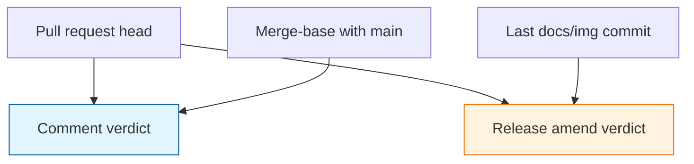

# Task: Promote demo verdicts out of shadow

* Task ID: issue-190-promote
* Complexity: Level 3
* Type: feature

The fingerprint verdicts already recorded on a pull request become the thing that expands, collapses, and labels each demo, and the thing that decides whether a release-please pull request amends `docs/img/`. The detector does not change.

## Pinned Info

### Two comparisons

The comment and the release amend ask different questions. One verdict function serves both. The workflow chooses the base tree.

## Component Analysis

### Affected Components

- `scripts/demo-fingerprint.ts`: Turns two recordings into a verdict. Gains a styling-only flag and the ffmpeg stack arguments. The retry rule stays.
- `scripts/demo-comment.ts` (new): Turns verdicts, text records, and image URLs into the comment body, and chooses which GIF paths a release amend may stage.
- `.github/workflows/generate-demos.yaml`: Today the git byte diff expands demos and triggers the amend, and the shadow step only prints a line. It will call the two modules and stop calling the byte diff.
- `.github/workflows/scripts/templates/demo-comment.md`: Drops the shadow disclaimer line. The per-demo blocks carry the verdict.
- `.github/workflows/scripts/generate-demo-comment.sh`: Builds the open and collapsed blocks from the byte-diff lists. That decision moves to the TypeScript module. The script is removed so two builders cannot disagree.
- `.github/workflows/scripts/detect-demo-changes.sh`: Compares GIF bytes. Nothing else may call it, and it is removed.
- `memory-bank/techContext.md`: Says expand and the release amend still follow the GIF diff. That sentence becomes false.

### Cross-Module Dependencies

- The workflow records tapes, then `demo-fingerprint.ts` reads the scratch tree.
- `demo-comment.ts` reads that same scratch tree and the uploaded image URLs. It does not record tapes and it does not run git.
- `scripts/generate-demo.js` stays the GIF-only path. It must not import either TypeScript module.
- The upload script publishes every `docs/img/*-demo.gif`. Preview extras use that naming so they get a URL. The comment's demo list comes from the tapes, not from every uploaded name.
- The release amend runs only after the comment recordings exist. It records one more base when the last `docs/img/` commit is not the merge-base, then stages paths the comment module names.

### Boundary Changes

- `describeVerdict` is a new exported result beside `assessFingerprints`. `assessFingerprints` keeps its return type.
- The comment body for a demo gains a verdict word. SAME, NOISY, and UNSTABLE are collapsed. CHANGED, NEW, and REMOVED are open. See `memory-bank/active/creative/creative-unspecified-verdicts.md`.
- The release amend's inputs change from "any GIF byte differs" to the path list from `selectReleaseAmend`. See `memory-bank/active/creative/creative-release-gif-amend.md`.
- No package export, npm API, or committed fingerprint file changes.

### Invariants & Constraints

- `assessFingerprints` keeps the pinned retry rule.
- A frame comparison's two sides are recorded in the same job. Frame hashes are not committed.
- Feature pull requests get no bot commit.
- UNSTABLE and NOISY still exit 0. `NEED_FRAME_RETRY` is internal: after the workflow's retry, a comment entry with that verdict is a failed job, not a SAME block.
- The GIF-only generator does not import the TypeScript modules.
- Do not point container `TMPDIR` at the scratch mount. Do not create `/tmp/vhs-frames` before `vhs`.
- `envsubst` does not see the comment body. A text diff can contain `$`.
- The amend stages only the paths `selectReleaseAmend` returns, and restores every other `docs/img/*-demo.gif` before it commits.

## Open Questions

- [x] Which trees decide a release-please GIF amend? → Resolved: last `docs/img/` commit versus the release head. Stage CHANGED, NEW, and REMOVED only (`memory-bank/active/creative/creative-release-gif-amend.md`)
- [x] How does the comment present REMOVED, UNSTABLE, and NOISY? → Resolved: collapse SAME, NOISY, and UNSTABLE with the verdict word. Open CHANGED, NEW, and REMOVED (`memory-bank/active/creative/creative-unspecified-verdicts.md`)

## Test Plan (TDD)

### Behaviors to Verify

- Text matches and frames differ, and the retry repeats that: `describeVerdict` → `CHANGED` and `stylingOnly: true`
- Text differs: `describeVerdict` → `CHANGED` and `stylingOnly: false`
- SAME, NEW, REMOVED, UNSTABLE, NOISY, and `NEED_FRAME_RETRY`: `stylingOnly: false`
- Two equal normalized records: `formatTextDiff` → empty string
- The issue's one-character validation lines: the result contains the old line prefixed with `-` and the new line prefixed with `+`, and does not list an unchanged line as both
- SAME entry: collapsed `
`, summary contains `(SAME)`, body is the after URL
- NOISY and UNSTABLE: collapsed, summary contains `(NOISY)` or `(UNSTABLE)`, body is the after URL
- CHANGED with a text diff: open `
`, summary contains `(CHANGED)`, body has the stacked URL and a collapsed block containing the diff
- CHANGED with `stylingOnly`: open, summary contains `styling only`, no text-diff block
- NEW: open, summary contains `(NEW)`, body is the after URL and not a stacked URL
- REMOVED: open, summary contains `(REMOVED)`, body is the before URL
- `NEED_FRAME_RETRY`: `renderDemoComment` throws
- CHANGED without a stacked URL, or REMOVED without a before URL: throws
- Every entry SAME: banner is the current stable sentence
- Any CHANGED, NEW, or REMOVED: banner is the current warning sentence
- Only SAME plus NOISY or UNSTABLE: banner does not say the demos are stable, and it does not use the warning sentence
- No entries: stable banner, and the list says no demo images are available
- `selectReleaseAmend`: CHANGED and NEW produce `docs/img/<name>-demo.gif` in `stage`; REMOVED produces that path in `remove`; SAME, NOISY, UNSTABLE, and `NEED_FRAME_RETRY` produce neither
- An unsafe demo name: `selectReleaseAmend` throws
- `formatAmendList`: one `stage` or `remove` line per path, stable order
- Scratch fixture with a frame-only change and a URL map: `loadCommentEntries` sets `stylingOnly`, leaves the text diff empty, and copies the stacked URL
- `buildDockerFfmpegStackArgs`: uses the given image, mounts the before, after, and output directories, includes the issue's `vstack` filter, and does not set `TMPDIR`
- `formatShadowLine`: still one sorted line, and the line does not say the verdicts are unused

### Test Infrastructure

- Framework: Vitest, via `npx vitest run -t "TEST_NAME"` and `npm test`
- Test location: `scripts/demo-fingerprint.test.ts` and `scripts/demo-comment.test.ts`
- Conventions: `describe` per function, `it` names the observable behavior, fixtures under `mkdtempSync`
- New test files: `scripts/demo-comment.test.ts`

### Integration Tests

- `loadCommentEntries` reads a scratch tree written the way `assessScratch` reads it, and returns the entries `renderDemoComment` and `selectReleaseAmend` consume. No Docker and no git.

## Implementation Plan

### 1. Styling-only flag — executable

- Files: `scripts/demo-fingerprint.ts`, `scripts/demo-fingerprint.test.ts`
- Creative ref: `memory-bank/active/creative/creative-unspecified-verdicts.md`

1. Stub tests: in `scripts/demo-fingerprint.test.ts`, empty cases for text-mismatch CHANGED, frame-stable CHANGED, and one non-CHANGED verdict.
2. Stub interface: `export function describeVerdict(input: AssessmentInput): { assessment: Assessment; stylingOnly: boolean }` with a doc comment. Body throws.
3. Write tests and run red: styling-only is true only for a CHANGED verdict whose first attempt has equal text and unequal frames. Every other verdict is false. `assessFingerprints` expectations stay as they are.
4. Write code and run green: `describeVerdict` calls `assessFingerprints` and sets the flag from the first attempt's text. Do not change the retry rule.

### 2. Text diff — executable

- Files: `scripts/demo-comment.ts`, `scripts/demo-comment.test.ts`

1. Stub tests: empty cases for equal records and for the one-character validation pair.
2. Stub interface: `export function formatTextDiff(baseText: string, headText: string): string`. Body throws.
3. Write tests and run red: equal strings return `''`. The validation pair's result contains `-` plus the old line and `+` plus the new line, and an unchanged `Search:` line is not emitted as both an add and a remove.
4. Write code and run green: a line diff with no new dependency. Identical input returns an empty string.

### 3. Comment body — executable

- Files: `scripts/demo-comment.ts`, `scripts/demo-comment.test.ts`, `.github/workflows/scripts/templates/demo-comment.md`
- Creative ref: `memory-bank/active/creative/creative-unspecified-verdicts.md`

1. Stub tests: one empty case per behavior listed for `renderDemoComment` in the test plan.
2. Stub interface: `DemoCommentEntry` and `export function renderDemoComment(entries: readonly DemoCommentEntry[]): { statusMessage: string; demoList: string }`. Body throws.
3. Write tests and run red: assert the summary word, open versus collapsed, which URL appears, the styling-only label, the collapsed diff, the three banners, the empty list, and the throws.
4. Write code and run green: render those blocks. Fill `.github/workflows/scripts/templates/demo-comment.md` by replacing the known tokens `CHANGE_STATUS_MESSAGE`, `DEMO_LIST`, `GITHUB_REPOSITORY`, `GITHUB_SHA`, and `USER_COMMIT_SHA` only. Remove the `${SHADOW_VERDICTS}` line from that template. Do not run `envsubst` on the result.

### 4. Release amend selection — executable

- Files: `scripts/demo-comment.ts`, `scripts/demo-comment.test.ts`
- Creative ref: `memory-bank/active/creative/creative-release-gif-amend.md`

1. Stub tests: empty cases for stage, remove, ignore, unsafe name, and the line formatter.
2. Stub interface: `export function selectReleaseAmend(entries: readonly { name: string; assessment: Assessment }[]): { stage: string[]; remove: string[] }` and `export function formatAmendList(selection: { stage: string[]; remove: string[] }): string`. Bodies throw.
3. Write tests and run red: paths are `docs/img/<name>-demo.gif`. CHANGED and NEW stage. REMOVED removes. SAME, NOISY, UNSTABLE, and `NEED_FRAME_RETRY` do neither. An unsafe name throws. The formatter emits `stage <path>` and `remove <path>` lines.
4. Write code and run green: call `assertSafeDemoName`. Sort by demo name.

### 5. Load comment entries from scratch — executable

- Files: `scripts/demo-comment.ts`, `scripts/demo-comment.test.ts`

1. Stub tests: an empty case for a frame-only scratch fixture, and an empty case for a missing stacked URL.
2. Stub interface: `export function loadCommentEntries(options: { scratchRoot: string; baseTapesDir: string; headTapesDir: string; imageUrls: Readonly<Record<string, string>> }): DemoCommentEntry[]`. Body throws.
3. Write tests and run red: a fixture with equal normalized text, unequal settled frames, and a `basic-before-after` URL yields `stylingOnly: true`, an empty text diff, and that stacked URL. A CHANGED text demo without its stacked URL throws.
4. Write code and run green: reuse `describeVerdict`, `readSide`, and `formatTextDiff`. Head URL key is the demo name. Stacked key is `<name>-before-after`. Removed before key is `<name>-before`.

### 6. FFmpeg stack arguments — executable

- Files: `scripts/demo-fingerprint.ts`, `scripts/demo-fingerprint.test.ts`

1. Stub tests: an empty case for the stack arguments.
2. Stub interface: `export function buildDockerFfmpegStackArgs(options: { image: string; beforeGif: string; afterGif: string; outputGif: string }): string[]`. Body throws.
3. Write tests and run red: the argv uses `options.image`, bind-mounts the three parent directories, includes `[0][1]vstack=inputs=2,split[a][b];[a]palettegen=stats_mode=diff[p];[b][p]paletteuse=dither=none`, and contains no `TMPDIR`.
4. Write code and run green: `docker run --rm` with `--entrypoint ffmpeg`. The output mount is writable. The inputs are read-only. This function does not run Docker.

### 7. Shadow line — executable

- Files: `scripts/demo-fingerprint.ts`, `scripts/demo-fingerprint.test.ts`

1. Stub tests: the existing `formatShadowLine` case is the test. Change its expected sentence in the write-tests step, not before.
2. Stub interface: none. The function already exists.
3. Write tests and run red: expect `Demo verdicts: basic SAME, validation NEED_FRAME_RETRY.` and expect the line not to contain `not used`.
4. Write code and run green: change the sentence in `formatShadowLine` and its doc comment. The job summary keeps the line. The comment template does not.

### 8. Wire the workflow — executable

- Files: `.github/workflows/generate-demos.yaml`, `.github/workflows/scripts/generate-demo-comment.sh`, `.github/workflows/scripts/detect-demo-changes.sh`
- Creative ref: both creative documents
- Behavior tests: steps 1–7. No test locks a YAML or shell string.

1. Stub tests: none. A test that the workflow file contains a command is a change-detector.
2. Stub interface: `export function parseCommentArgs` only if the workflow needs a CLI. Prefer calling the tested functions from a `main` guarded the way `demo-fingerprint.ts` already is. Add the signature in `scripts/demo-comment.ts` with a throwing body if a new flag parser is required.
3. Write tests and run red: extend `parseCommentArgs` tests only for flags the unit layer does not already cover. Do not assert on the workflow file.
4. Write code and run green, in this order:
    1. Rename the shadow step so its name no longer says the verdicts are unused. Keep the merge-base recording and the one retry.
    2. For each CHANGED demo, run `buildDockerFfmpegStackArgs` against the head image and write `<name>-before-after-demo.gif` into `docs/img/`. For each REMOVED demo, copy the base scratch GIF to `docs/img/<name>-before-demo.gif`.
    3. Run the upload after those preview files exist.
    4. Build the comment with `loadCommentEntries` and `renderDemoComment`, and write that body to the pull-request comment.
    5. Delete the "Check which demos changed" step and stop passing `--changed-demos` and `--new-demos`.
    6. On a release-please pull request, take the amend base with `git log -1 --format=%H -- docs/img` from the pull request base. When that SHA is not the merge-base, record it into a second scratch root, symlink the already recorded head side, and run `loadCommentEntries` for the amend only. When the SHAs match, reuse the comment verdicts.
    7. Copy `docs/img/*.gif` to `$RUNNER_TEMP` before `git checkout` of the release branch. After checkout, restore only SAME, NOISY, and UNSTABLE GIFs from git, copy back the CHANGED and NEW GIFs from `$RUNNER_TEMP`, and apply `formatAmendList`. Skip the commit when the list is empty. Keep the bot actor check and `--force-with-lease`.
    8. Give the extra release recording its own 20 minute step. Do not lengthen the existing shadow step to cover a third tree.
    9. Delete `generate-demo-comment.sh` and `detect-demo-changes.sh` after nothing in the workflow calls them.

### 9. Tech context — prose/policy

- Files: `memory-bank/techContext.md`
- No tests: prose/policy artifact

1. Replace the sentence that says expand and the release amend follow the GIF diff. State that the comment uses the merge-base verdict, and that a release amend compares the last `docs/img/` commit to the release head.
2. Leave the VHS `TMPDIR` and frames-directory warnings as they are.

## Technology Validation

No new technology - validation not required. FFmpeg stays the binary already in the VHS image. No new npm dependency.

## Challenges & Mitigations

- Docker and FFmpeg are not available for the unit run: the tests assert argument lists and scratch fixtures. The first Generate job on the pull request is the integration check.
- `git checkout` of the release branch can drop the generated GIFs: copy them to `$RUNNER_TEMP` before checkout and copy back only the staged names.
- A text diff run through `envsubst` would lose `$`: the comment is filled by replacing known tokens.
- A third full recording can blow the 20 minute shadow cap: the gif-commit recording is a separate step, and it is skipped when that commit is already the merge-base.
- The uploader treats every `*-demo.gif` as a demo: the comment list comes from `loadCommentEntries`, and the amend list is the explicit path list.
- `generate-demo.js` importing the new module would put type stripping on the GIF-only path: the workflow starts `node` on the TypeScript files itself, and the GIF script stays untouched.

## Pre-Mortem

- One comparison used for both the comment and the amend, so README GIFs freeze or the comment lies about the pull request: the plan keeps two bases, from the release-amend creative decision.
- The comment rules stay in bash and ship without a test: steps 3–5 put the rules in Vitest. The workflow step only calls them.
- Preview GIFs and unchanged GIF bytes land on the release commit: the amend copies back an explicit list and restores everything else first.
- SAME is only a collapsed box, with no verdict word: the render tests require `(SAME)`.

## Status

- [x] Component analysis complete
- [x] Open questions resolved
- [x] Test planning complete (TDD)
- [x] Implementation plan complete
- [x] Technology validation complete
- [x] Pre-Mortem complete
- [ ] Preflight
- [ ] Build
- [ ] QA
